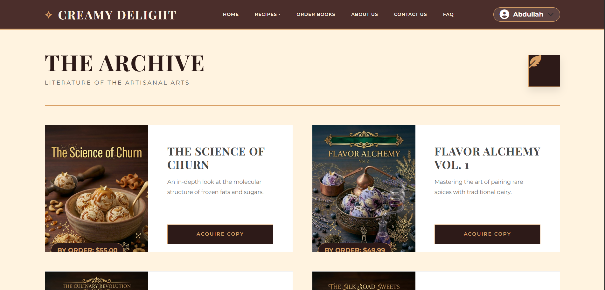
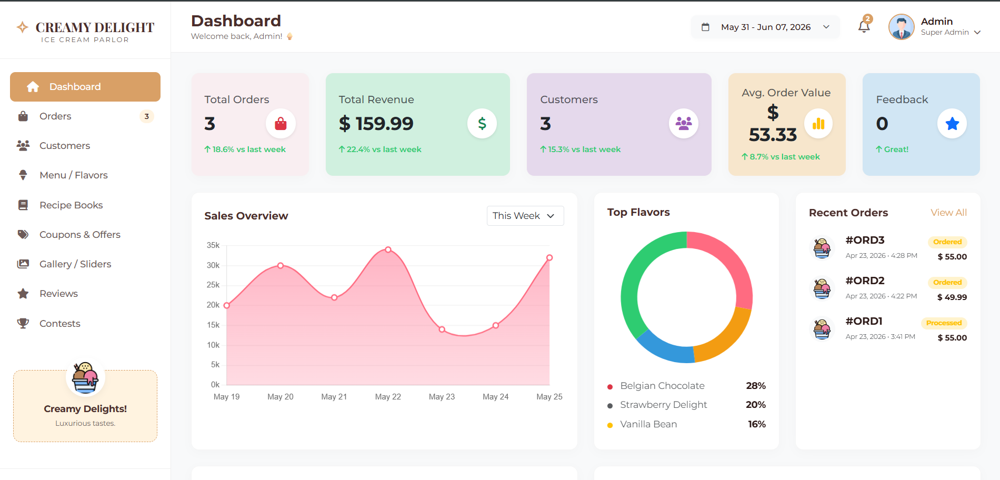

# Creamy Delight - Premium Sweet Scoops Ice Cream Parlor

Welcome to **Creamy Delight**, a premium and elegant ASP.NET Core MVC web application designed for an elite ice cream parlor. The application provides an engaging user experience with dynamic hero sliders, subscription models, recipe sharing, books e-commerce, and a robust administrative panel.

---

## 🍦 Key Features

### 1. User & Authentication Management
- **Security**: Complete authentication mechanism utilizing BCrypt password hashing.
- **Verification**: Automatic 6-digit email verification with expiration checking to active user profiles.
- **Profiles**: Personalized user profiles tracking orders, certificates, submission status, and options to upgrade subscription tiers.

### 2. Premium Subscription Membership
- **Tiers**: Guest (Free), Monthly ($15/mo), and Yearly ($150/yr) memberships.
- **Payments**: Integrated simulated payments via Stripe (custom masters/visas token charging).
- **Access Control**: Locking premium recipes specifically for paid subscribers.

### 3. Artisanal Recipes & Submissions
- **Menu**: Interactive view of all recipes with categorization filters (e.g. Free Recipes).
- **Artisanal Registry**: Logged-in users can submit custom recipes to win prizes and certificates.
- **Awards**: Winners get a digital certificate generated automatically and listed on the home page showcase.

### 4. Recipe Books E-Commerce
- **Catalog**: A premium store interface displaying cookbooks.
- **Checkout**: Seamless checkout system requiring customer details, address, contact, and credit card processing.

### 5. Admin Dashboard
- **Analytics**: Key stats (total users, total orders, recipes, revenue, average order value).
- **Content Management**: Manage recipes, books, hero sliders, deals, and testimonial feedbacks.
- **Submissions**: Approve and award prize money & certificates to user-submitted recipes.

### 6. Validation System
- **Phone Validation**: Pakistani format phone numbers (must start with `03` and have exactly 11 digits, e.g., `03001234567`) are enforced server-side and client-side via regular expressions on both Registration and Book Checkout forms.
- **Client-Side Validation**: Unobtrusive jQuery validation integration for instantaneous validation feedback.

---

## 📸 Screenshots

### 🏠 Home Page


### 🍨 Artisanal Recipes Menu


### 📚 Book Ordering Page


### 📊 Admin Control Center


---

## 🛠️ Technology Stack
- **Backend Framework**: ASP.NET Core 8.0/10.0 (MVC Architectural Pattern)
- **Database**: Entity Framework Core & MS SQL Server
- **Authentication**: Custom Session & Cookie-based with BCrypt Hashing
- **Cloud Media**: Cloudinary Service for image assets upload
- **Payments**: Stripe .NET Integration
- **Frontend UI**: Bootstrap 5, Custom CSS, and Font Awesome Icons
- **Validations**: Data Annotations, jQuery Unobtrusive Validation

---

## 🚀 How to Run Locally

### Prerequisites
- [.NET 8.0 SDK](https://dotnet.microsoft.com/download/dotnet/8.0) or higher
- [SQL Server LocalDB](https://learn.microsoft.com/en-us/sql/database-engine/configure-windows/sql-server-express-localdb) (comes with Visual Studio)

### Step 1: Clone and Restore
```bash
git clone https://github.com/AbdullahAnis1549/ice-cream-parlour-mvc.git
cd ice-cream-parlour-mvc/WebApplication12
dotnet restore
```

### Step 2: Database Setup
Configure SQL Server from the project directory, then apply migrations.
```bash
dotnet user-secrets set "ConnectionStrings:DefaultConnection" "<your SQL Server connection string>"
dotnet ef database update
```

### Integration settings

Use .NET User Secrets for local development. Set each integration key with the same command format as the connection string above.

- Email delivery uses the FromEmail, SmtpServer, Port, Username, and Password keys under EmailSettings.
- Image uploads use the CloudName, ApiKey, and ApiSecret keys under CloudinarySettings.
- The checkout and paid membership flows use Stripe:SecretKey. They currently use Stripe test tokens and are for demos.

For deployment, set the same keys as environment variables using double underscores for section separators. For example, use ConnectionStrings__DefaultConnection and EmailSettings__Password. Enter credentials directly in your host's configuration.

If credentials from earlier commits are active, revoke or rotate them with the provider and update the deployment configuration. Cleaning the current source tree leaves earlier Git revisions intact.

### Step 3: Run the Application
Start the development server:
```bash
dotnet run
```
Open `http://localhost:5000` (or the console output URL) in your web browser to enjoy!
